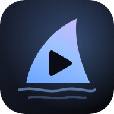
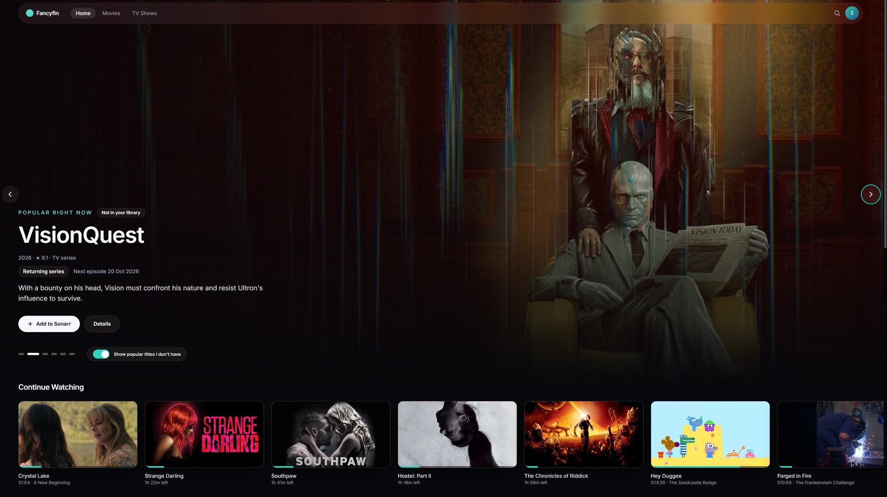
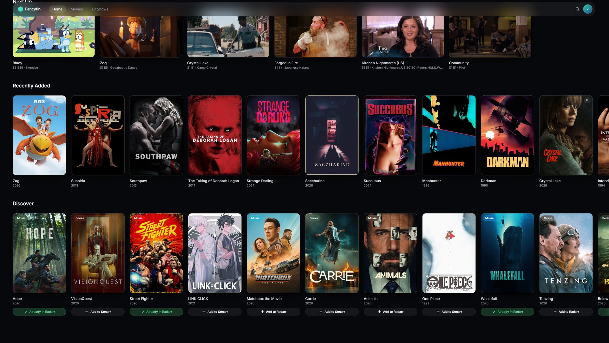
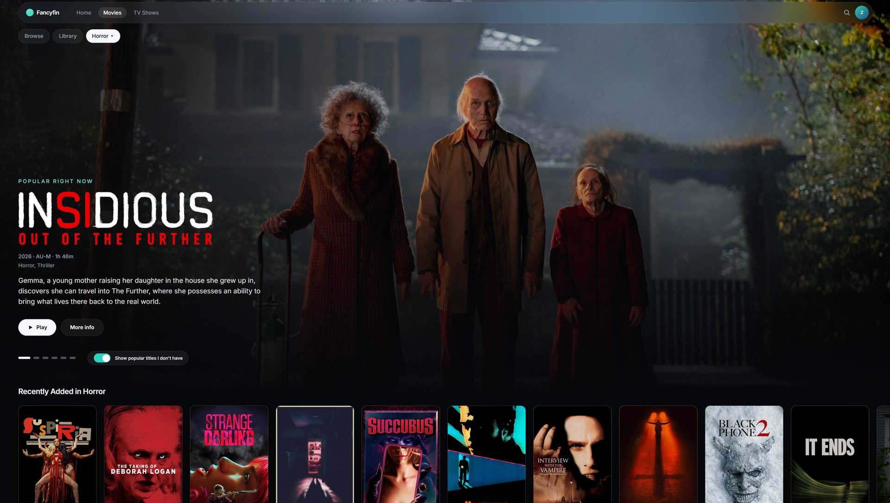
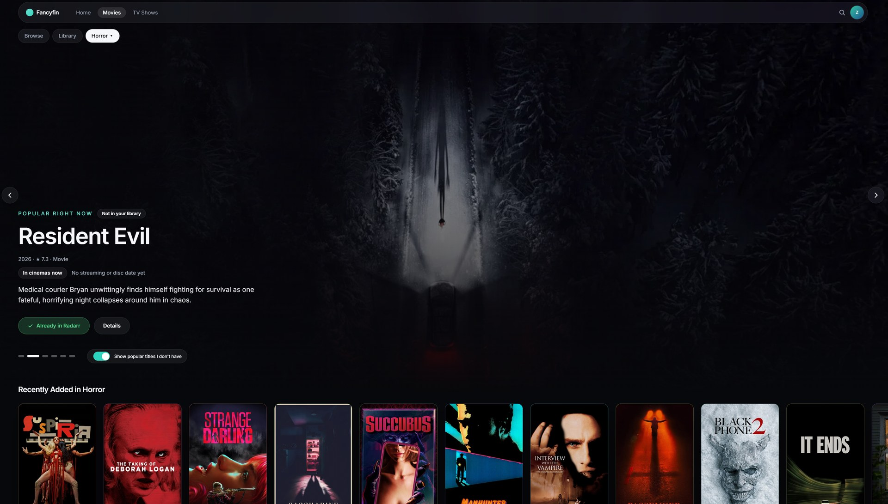
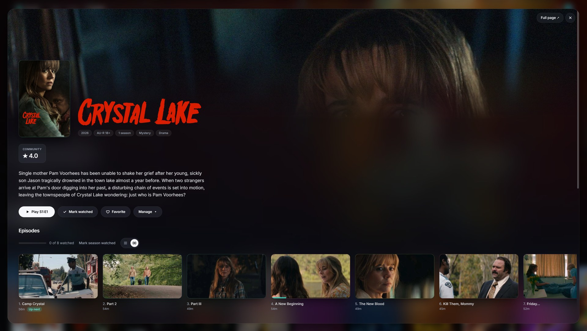
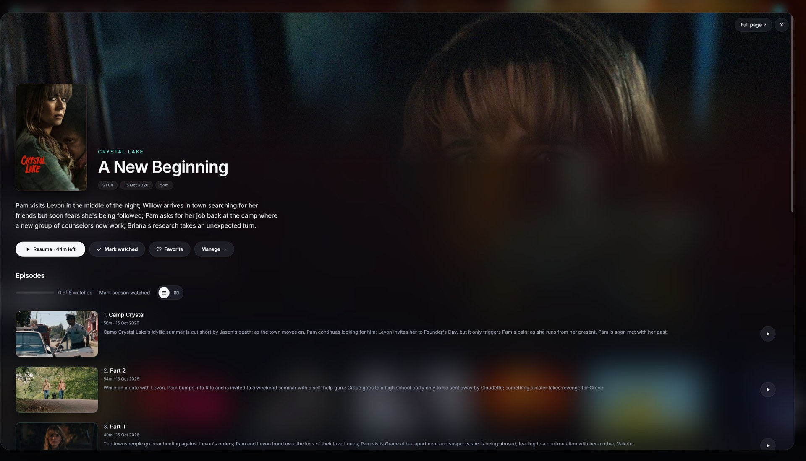
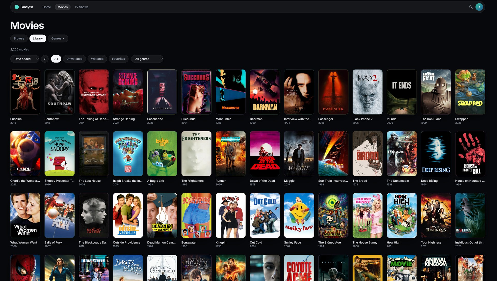
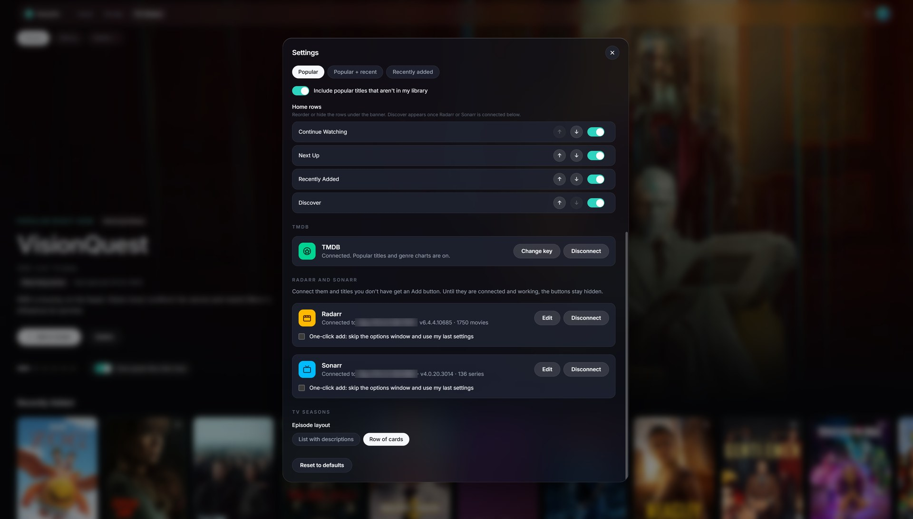

# Fancyfin

<p align="left"></p>

A modern, cinematic web client for Jellyfin. Beautiful browsing, smooth playback, and styled subtitles, built on the public API.

Fancyfin talks only to the public Jellyfin API, so your server stays stock and updates never break it. See [PLAN.md](PLAN.md) for goals, stack and milestones.

> **Status:** first release (0.1). Browsing, detail pages, playback (direct play and HLS transcode), subtitles (SRT, VTT, ASS/SSA, burned-in image subs), audio track selection and search all work. Expect rough edges.

## Install on Unraid (Community Apps)

Fancyfin is in the Unraid Community Applications store.

1. In Unraid, open the **Apps** tab and search for **Fancyfin**.
2. Click **Install**.
3. On the install page, check the settings:
   - **WebUI Port**: the port to open Fancyfin on (default `8282`).
   - **Jellyfin URL** (optional): your Jellyfin address as the container sees it, for example `http://192.168.1.20:8096`. Leave it empty and Fancyfin asks the first time you open it.
   - **Config**: a folder in your appdata (default `/mnt/user/appdata/fancyfin`). It keeps your TMDB, Radarr and Sonarr connections, so they survive updates.
4. Click **Apply**, then open `http://<unraid-ip>:8282` (or click the container's icon on the **Docker** tab and choose **WebUI**).
5. Sign in with your Jellyfin account. Connect TMDB, Radarr and Sonarr from the avatar menu under **Settings**.

To update, use **Check for updates** on the **Docker** tab, then **apply update**.

More ways to run it (Docker, compose, the template without Community Apps) are under [Docker](#docker) and [Unraid](#unraid).

## Screenshots

| | |
|---|---|
|  |  |
|  |  |
|  |  |
|  |  |

## Local development

Requirements: Node 22+ and [pnpm](https://pnpm.io/installation) 10+.

```bash
pnpm install

# Point the dev server at your Jellyfin
cp .env.example .env.local        # Windows PowerShell: Copy-Item .env.example .env.local
# edit .env.local and set JELLYFIN_URL, e.g. http://192.168.1.50:8096

pnpm dev                          # add --host to open it from your phone on the same network
```

TMDB (the "popular right now" banner), Radarr and Sonarr are connected in Settings, with `pnpm dev:server` running in a second terminal (see [Popular banner](#popular-banner-tmdb) and [Add to Radarr and Sonarr](#add-to-radarr-and-sonarr)).

The app calls Jellyfin through `/api`, which the Vite dev server (and the Docker image's nginx) proxy to `JELLYFIN_URL`. That means no CORS setup is needed on the Jellyfin server.

### Scripts

| Command | What it does |
|---|---|
| `pnpm dev` | Dev server with hot reload |
| `pnpm build` | Typecheck and production build to `dist/` |
| `pnpm typecheck` | TypeScript only |
| `pnpm lint` | Biome lint and format check |
| `pnpm format` | Biome auto-fix |
| `pnpm test` | Unit tests (Vitest) |

## Docker

```bash
docker compose up --build         # then open http://localhost:8282
```

`JELLYFIN_URL` is optional:

- **Set it** (the address of your Jellyfin server as seen from the container, e.g. `http://192.168.1.20:8096`) and the container proxies to Jellyfin for you. No CORS setup is needed.
- **Leave it empty** and Fancyfin asks for the Jellyfin address the first time you open it, then remembers it in your browser. In this mode your browser talks to Jellyfin directly, so the address must be reachable from the device you browse on, and (if Fancyfin is served over HTTPS) Jellyfin must be HTTPS too.

### Popular banner (TMDB)

The featured banner on Home and the Movies and TV Shows pages can show what's popular right now, using [TMDB](https://www.themoviedb.org/). Popular titles you own are matched to your library and play as normal. Popular titles you don't own are shown for inspiration, with a "Not in your library" label and a link to TMDB; there is a switch on the banner (and in Settings) to hide them. Pick a genre on Movies or TV Shows and the banner shows the most popular titles in that genre instead.

1. Create a free TMDB account and copy your API key (or "API Read Access Token") from your account's API settings.
2. In Fancyfin open **Settings**, find **TMDB**, choose **Connect** and paste the key. Fancyfin checks it with TMDB before saving.

The key is saved on the server (in the `/config` folder) and the browser never sees it: the browser only talks to `/tmdb` on your Fancyfin address, and the server adds the key. Never commit the key to the repository. Without a key the banner shows recently added titles.

### Android TV app

`android/` holds a small Android TV app (for example for an NVIDIA Shield) that shows Fancyfin full screen from your own server, with a built-in updater so you only sideload it once. Setup, signing key and installing are in [android/README.md](android/README.md). Inside the app, Settings has a **TV app** section.

### Add to Radarr and Sonarr

Titles you don't have can be sent straight to [Radarr](https://radarr.video/) (movies) or [Sonarr](https://sonarr.tv/) (TV) so they get collected. The Add buttons appear on "Not in your library" banner slides, in the **Discover** row on Home and in the "Not in your library" group in search results (all of which need TMDB, above), but only once the app is connected and working in Settings.

1. Open **Settings, Radarr and Sonarr**.
2. **Connect** each app: its address as the Fancyfin container can reach it (e.g. `http://192.168.1.20:7878`, with the URL base if you set one) and its API key (Radarr or Sonarr, **Settings, General**). Fancyfin tests the connection before saving, and shows the version and library size once connected. Until a connection is saved and working, no Add buttons show.
3. Click **Add to Radarr / Sonarr**. A window lets you pick the match (if it guessed wrong), root folder (with free space), quality profile, minimum availability (movies) or monitoring and series type (shows), and whether to start searching straight away. Tick **One-click add** (in Settings, or **Next time, skip this window** in the window) to add in one click with your last settings.

How it works: a small service inside the container keeps the address and key in `/config` and talks to Radarr and Sonarr for you. The keys are never sent to the browser, and only the few calls the Add window needs are allowed. There is no separate permission check: anyone who can open your Fancyfin can use the buttons and change the connection, so keep Fancyfin on your own network. **Map a path to `/config`** (the Unraid template does) or the connection is forgotten when the container is replaced. Works with Radarr v5 and Sonarr v4. For `pnpm dev`, run `pnpm dev:server` in a second terminal.

### Settings

The avatar menu has **Settings**: accent colour, poster corners and size, glass strength, titles under posters, banner size and source, which Home rows show and in what order, episode layout and animations. They are saved in the browser you change them in.

### Published images

GitHub Actions builds and publishes to `ghcr.io/zombifiedturkey/fancyfin`:

| Tag | Follows |
|---|---|
| `edge` | every push to `main` (latest development build) |
| `latest`, `1.2.3` | tagged releases (`v1.2.3`) |
| `sha-xxxxxxx` | a specific commit |

### Unraid

**From Community Apps (recommended)**

See [Install on Unraid (Community Apps)](#install-on-unraid-community-apps) above.

**Using the template directly** (if you can't use the Apps tab)

1. Open the Unraid web terminal (or SSH in) and run:
   ```bash
   wget -O /boot/config/plugins/dockerMan/templates-user/my-fancyfin.xml \
     https://raw.githubusercontent.com/zombifiedturkey/Fancyfin/main/unraid/fancyfin.xml
   ```
   (Or copy `unraid/fancyfin.xml` from this repo to `\\<unraid>\flash\config\plugins\dockerMan\templates-user\my-fancyfin.xml`.)
2. **Docker** tab, **Add Container**, then pick **Fancyfin** from the template dropdown.
3. Adjust the port if 8282 is taken. **Jellyfin URL** is optional: set it, or leave it empty to enter the address in Fancyfin on first use. **Config** maps `/config` to a folder in your appdata (it keeps your TMDB, Radarr and Sonarr connections, which you set up in Settings). **Apply**.
4. Open `http://<unraid-ip>:8282`.

**Without the template**

**Docker** tab, **Add Container**, leave the template empty and fill in:
Repository `ghcr.io/zombifiedturkey/fancyfin:latest`, a port mapping to container port `80`, and optionally the variable `JELLYFIN_URL`, and a path mapping `/config` to a folder in your appdata.

Use the `edge` tag instead of `latest` for the development build. To update, use **Check for updates** on the Docker tab, then **apply update**. If pulling fails, make sure the package is public in the repository's package settings on GitHub.

## Releasing (maintainers)

1. Move the notes in `CHANGELOG.md` under a new `## x.y.z` heading, and set `version` in `package.json`.
2. Commit and push to `main`, wait for CI to pass.
3. Tag and push: `git tag vx.y.z && git push origin vx.y.z`. This publishes the image as `:latest` and `:x.y.z` and creates the GitHub release.
4. The Unraid template follows `:latest`, so installs pick the update up through **Check for updates**.

The Android TV app is released separately with `tv-v*` tags.

## License

[MIT](LICENSE)

## Credits and disclaimer

Fancyfin is an independent project. It is not affiliated with or endorsed by the Jellyfin project. Jellyfin is a trademark of its owners. Radarr and Sonarr are separate projects that Fancyfin connects to through their public APIs.

This product uses the TMDB API but is not endorsed or certified by TMDB. Popular titles, release dates, genres and details for titles you don't own come from [The Movie Database](https://www.themoviedb.org/).
